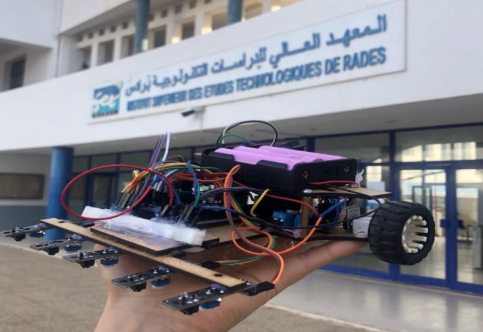

# PID Line-Following Robot

A collaborative robotics project by **Mohamed Aziz Turki and Amen Allah Bayoudh**, built around a line follower for competition tracks.

The documented prototype uses an Arduino Mega, five IR sensors, encoder feedback, and PID steering. Two N20 motors and an L298 driver power the robot.

## Project photo

*Line-following robot prototype outside the ISET Radès building.*

## Project overview

- IR sensors track the course line.
- Encoder readings are combined with sensor readings for PID steering.
- PID parameters are tuned to suit each track.

## Repository contents

This repository is a project showcase with a project overview and photo documentation. It does not include the original source code.
